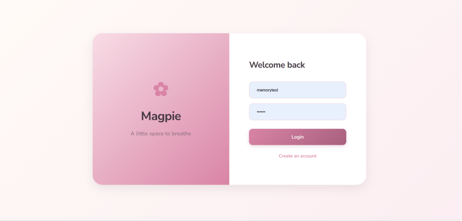
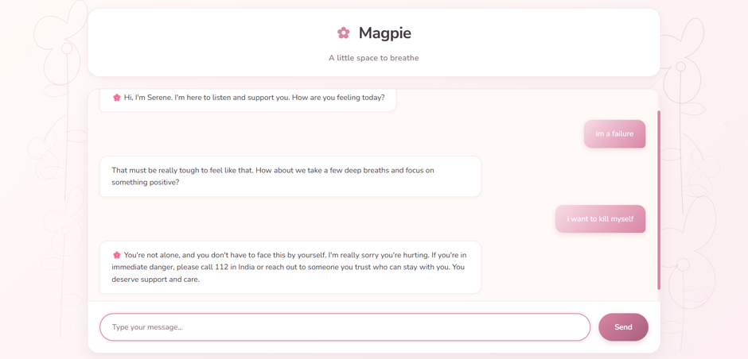
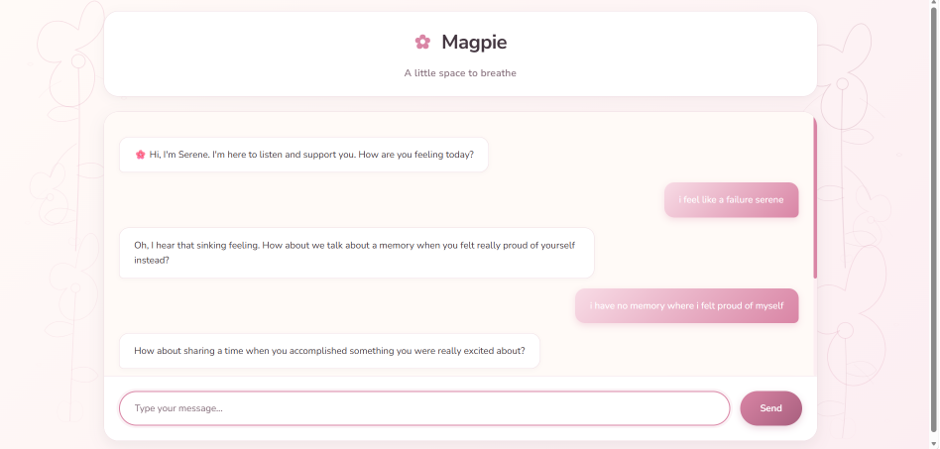
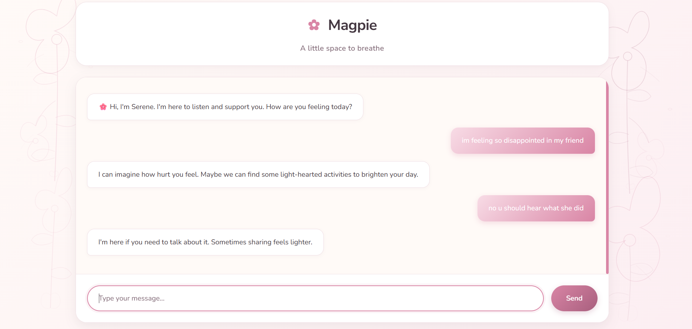
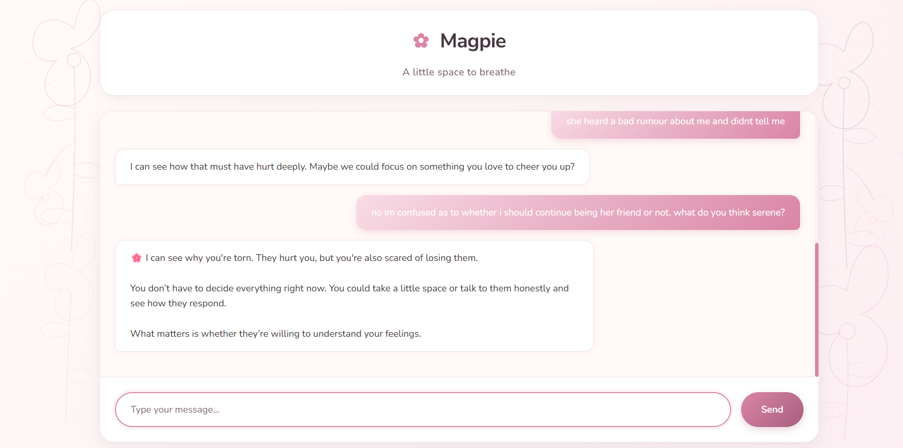
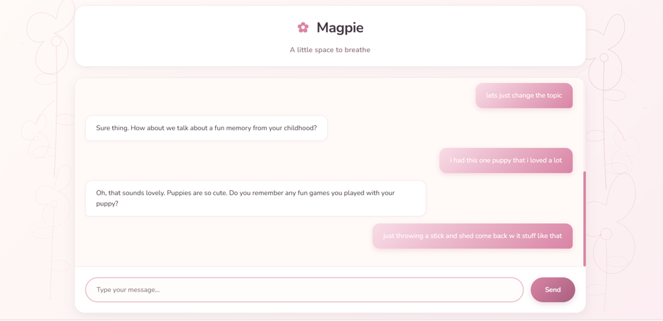
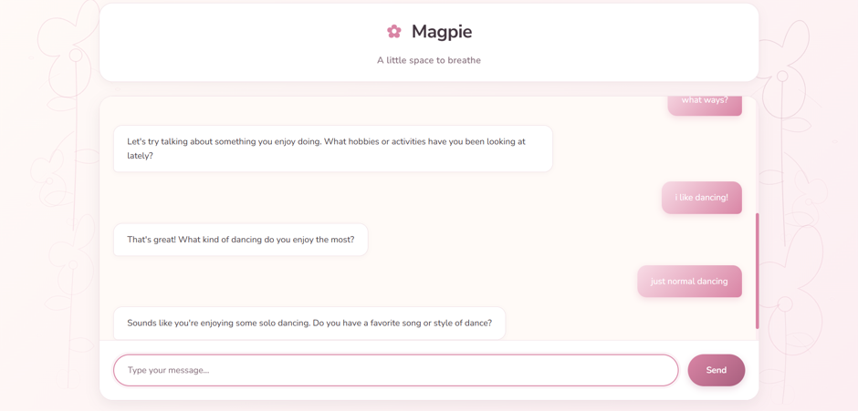
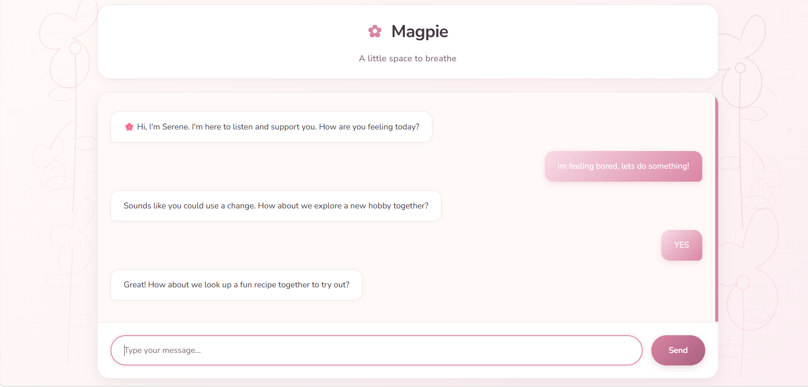
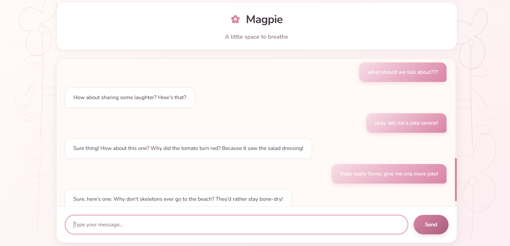

# 🌸 Magpie — A Little Space to Breathe

Magpie is an AI-powered mental wellness chatbot designed to provide a warm, supportive space for people to express their thoughts and feelings. Built with Python, Flask, Ollama, and SQLite, Magpie combines a locally running language model with lightweight retrieval and conversation context to generate empathetic responses.

> **Disclaimer:** Magpie is a personal project for conversational support and is not a substitute for professional mental health care. Its crisis-response mechanism is a basic keyword-based failsafe, not a comprehensive safety system.

## 📸 Screenshots

### Login Page



### Crisis Response

Magpie includes a keyword-based failsafe that returns a predefined response when certain suicide-related phrases are detected.



### Supportive Conversations

Magpie is designed to respond conversationally to different topics, including emotional distress, friendship concerns, loneliness, and everyday activities.







### Everyday Conversations

The chatbot can also engage in casual conversations about hobbies, recipes, jokes, and changing topics.











## ✨ Features

- **AI-powered conversations:** Uses a locally running language model to generate friendly, supportive responses.
- **Prompt engineering:** Guides the model toward a warm, empathetic conversational style.
- **Lightweight RAG:** Retrieves potentially relevant information from a small, hard-coded mental health knowledge base using lexical matching.
- **Conversation context:** Stores user and assistant messages and uses selected recent conversation history to help maintain context.
- **User authentication:** Supports account registration and login using Flask sessions and password hashing.
- **Crisis keyword failsafe:** Returns a predefined response when configured suicide-related keywords are detected.
- **Fallback handling:** Provides basic fallback responses when the local model cannot generate a usable answer.
- **Custom UI:** A responsive chat interface with a soft pink-and-ivory theme and botanical illustrations.

## 🛠️ Tech Stack

| Component | Technology |
|---|---|
| Backend | Python, Flask |
| Language Model | Qwen2.5 3B |
| Local Model Runtime | Ollama |
| Retrieval | Custom lexical retrieval |
| Database | SQLite |
| ORM | Flask-SQLAlchemy / SQLAlchemy |
| Authentication | Flask Sessions, Werkzeug |
| Frontend | HTML, CSS, JavaScript |
| Version Control | Git |

## 🧠 How It Works

1. **Authentication:** Users register or log in to access the chatbot.
2. **Message submission:** The frontend sends the user's message to the Flask backend.
3. **Safety check:** The backend checks for configured crisis-related keywords and returns a predefined response if a match is detected.
4. **Context retrieval:** For regular messages, the application retrieves relevant entries from its knowledge base and selected conversation history using lexical matching.
5. **Prompt construction:** Retrieved information and conversation context are included in the prompt.
6. **LLM response:** The backend sends the prompt to the locally running Qwen2.5 3B model through Ollama.
7. **Storage:** User messages and assistant responses are stored in SQLite.

### Retrieval-Augmented Generation (RAG)

Magpie implements a lightweight, custom retrieval approach using keyword and partial-string matching, along with Python's `SequenceMatcher`, to identify potentially relevant information.

This implementation does **not** use embedding-based semantic search, a vector database, or a dedicated RAG framework such as LangChain.

### Crisis-Response Mechanism

The current implementation checks a limited set of configured phrases, including `suicide`, `kill myself`, and `i want to die`. When a match is found, the application bypasses the LLM and returns a predefined safety response.

This is a basic keyword-based mechanism. It can miss expressions that use different wording and should not be relied upon for crisis assessment or emergency support.

If you are in immediate danger in India, call **112** or contact someone who can help you reach immediate support.

## 🚀 Getting Started

### Prerequisites

- Python installed
- [Ollama](https://ollama.com/) installed and running
- The Qwen2.5 3B model downloaded locally

### 1. Clone the Repository

```bash
git clone https://github.com/AditiWarrier/mental-health-chatbot.git
cd mental-health-chatbot
```

### 2. Navigate to the Backend

```bash
cd backend
```

### 3. Create a Virtual Environment

```bash
python -m venv .venv
```

Activate it on Windows PowerShell:

```powershell
.\.venv\Scripts\Activate.ps1
```

On macOS or Linux:

```bash
source .venv/bin/activate
```

### 4. Install Dependencies

```bash
pip install -r requirements.txt
```

### 5. Download the Model

Make sure Ollama is running, then execute:

```bash
ollama pull qwen2.5:3b
```

The application communicates with Ollama through its local generation API at:

```text
http://localhost:11434/api/generate
```

### 6. Run the Application

From the `backend/` directory:

```bash
python app.py
```

Open the application in your browser:

```text
http://127.0.0.1:5000/
```

## 📂 Project Structure

```text
mental-health-chatbot/
├── backend/
│   ├── app.py
│   ├── requirements.txt
│   ├── static/
│   │   ├── script.js
│   │   └── style.css
│   ├── templates/
│   │   ├── index.html
│   │   ├── login.html
│   │   └── register.html
│   └── users.db
├── screenshots/
└── README.md
```

The main Flask application contains the active routes, authentication, database interactions, retrieval logic, safety check, and Ollama integration. The frontend uses HTML, CSS, and vanilla JavaScript.

The SQLite database is created or used locally by the application. Avoid committing a database containing real user accounts or conversation data.

## ⚠️ Limitations

- The knowledge base is small and hard-coded.
- Lexical retrieval may miss relevant information and is less capable than semantic retrieval.
- Responses generated by an LLM may be inaccurate, repetitive, or unsuitable.
- The crisis failsafe checks only a limited set of keywords and is not comprehensive.
- Conversation history is stored in SQLite, but the interface does not provide a complete history-browsing or deletion feature.
- The application is a prototype and has not been established as production-ready.

Before public deployment, additional security and operational work would be necessary, including replacing the development secret key, disabling debug mode, and reviewing session security, CSRF protection, rate limiting, and data handling.

## 🔮 Future Improvements

- Introduce embedding-based retrieval and a vector database.
- Expand and evaluate the knowledge base.
- Add automated tests for authentication, retrieval, and response handling.
- Improve crisis-response coverage and test safety behavior more comprehensively.
- Add controls for viewing and deleting conversation history.
- Add production deployment configuration and monitoring.
- Evaluate response relevance, reliability, and safety systematically.

## 💗 Project Purpose

Magpie explores how locally hosted language models, prompt engineering, lightweight retrieval, and conversational context can be combined to build an AI-powered mental wellness support application.

**Built with Python, Flask, Ollama, and SQLite. 🌸**
